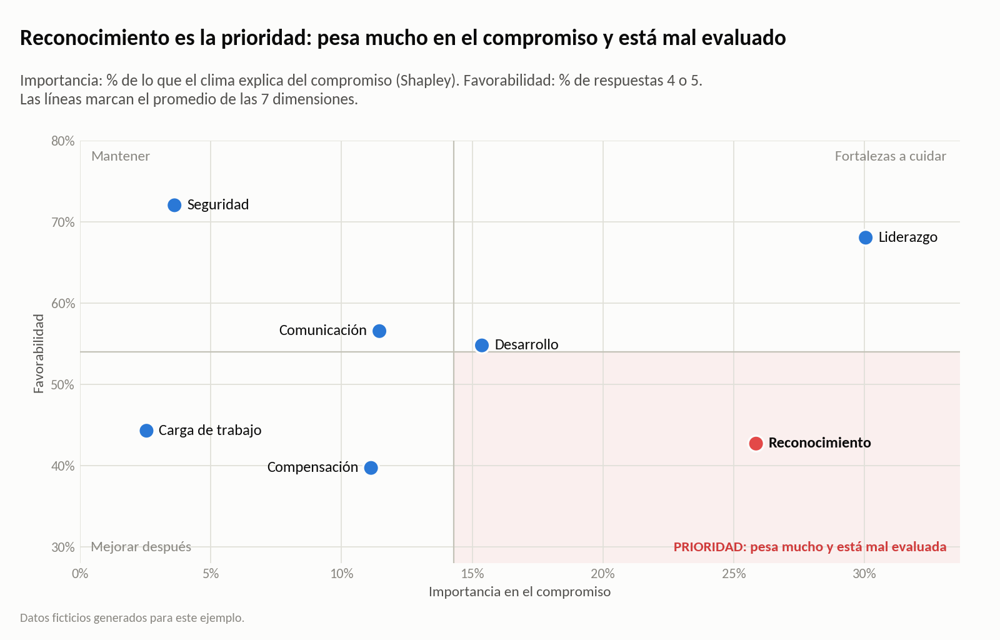
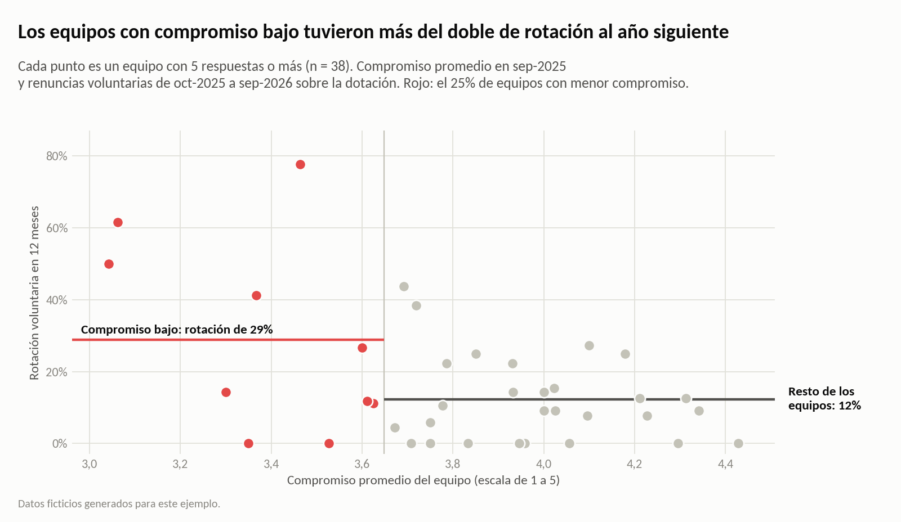
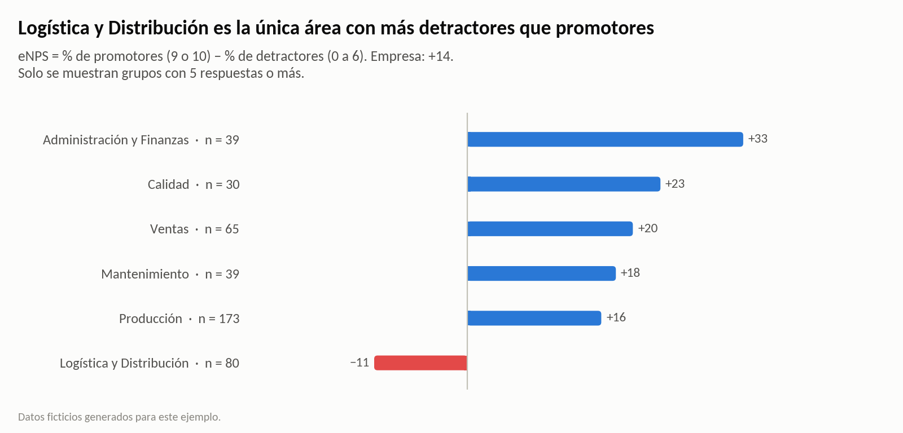
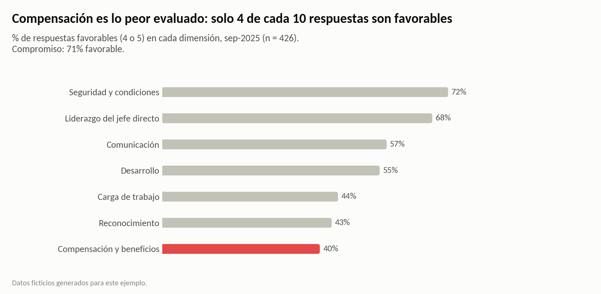
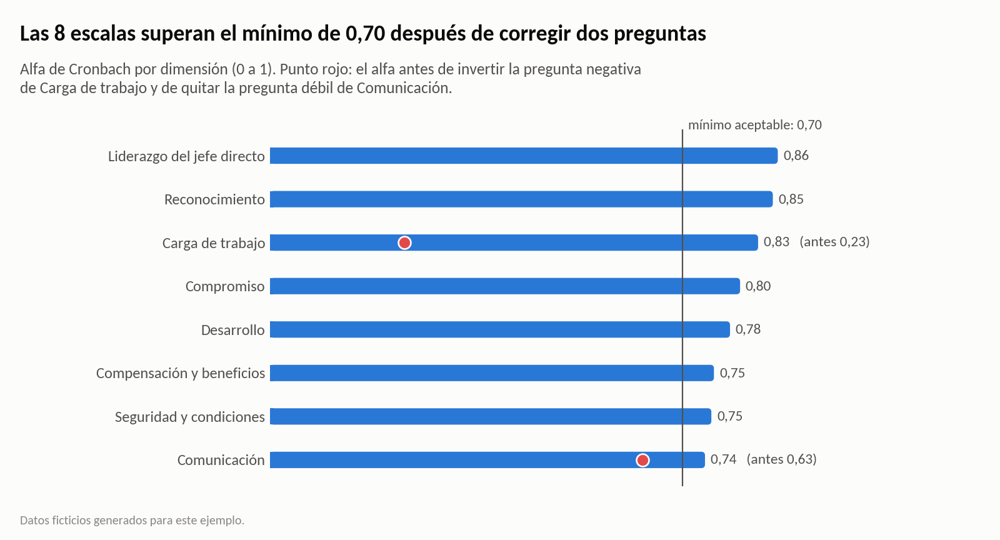

# ¿Qué explica el compromiso de la gente y cuánto cuesta descuidarlo?

**People Analytics y psicometría con Python.** Este análisis toma una encuesta de clima, comprueba que mida bien y encuentra qué pesa más en el compromiso. Después cruza el compromiso de cada equipo con sus renuncias del año siguiente para estimar cuánto cuesta descuidarlo, en bolivianos.



> **Datos ficticios.** Corresponden a la encuesta anual de clima de septiembre de 2025 de una embotelladora mediana de 520 colaboradores en 40 equipos, y a las renuncias de cada equipo entre octubre de 2025 y septiembre de 2026. Se generan con `generar_datos.py`. Los números sirven para mostrar el método; no describen a ninguna empresa real.

## Resultados

| Pregunta | Respuesta |
|---|---|
| ¿La encuesta mide bien? | Sí, después de dos correcciones: invertir una pregunta redactada en negativo y quitar una pregunta débil (correlación ítem-total de **0,13**). Las 8 escalas quedan con un alfa de Cronbach de **0,74 a 0,86**, y en el análisis factorial 27 de las 28 preguntas de clima cargan en su dimensión. |
| ¿Qué explica el compromiso? | Sobre todo, el jefe directo y el reconocimiento: **Liderazgo (30%)** y **Reconocimiento (26%)** suman el 56% de lo que el clima explica del compromiso (R² = 0,62). Compensación es lo peor evaluado (**40%** favorable), pero pesa menos (11%). |
| ¿Dónde está peor? | En **Logística y Distribución**. Es la única área con eNPS negativo (**−11**, contra +14 de la empresa) y la peor evaluada en liderazgo (48% favorable) y en carga de trabajo (28%). |
| ¿Cuánto cuesta descuidarlo? | El 25% de equipos con menor compromiso tuvo una rotación de **28,8%** al año siguiente, contra **12,3%** del resto. Con la rotación del resto, serían **unas 19 a 21 renuncias menos**: entre **Bs 213 mil y Bs 232 mil al año**, a Bs 11.240 por renuncia. Es una asociación, no una prueba de causa. |
| ¿Qué hacer primero? | **Trabajar el reconocimiento a través de los jefes directos.** Es la única dimensión que pesa mucho y está mal evaluada (**43%** favorable), y es la prioridad número 1 en las 6 áreas. Empezar por los 10 equipos de compromiso bajo, 5 de ellos en Logística. |

## Cómo se hizo

1. **Datos.** `generar_datos.py` simula a 520 personas en 40 equipos. Cada persona tiene un nivel latente (no observado) en 7 dimensiones de clima, correlacionadas entre sí y afectadas por el área, el nivel, la antigüedad, el turno y el jefe directo. Cada respuesta es latente más ruido, llevada a la escala de 1 a 5. No todos responden, y las renuncias de cada equipo dependen del compromiso de su gente, con ruido.
2. **Confiabilidad.** Alfa de Cronbach programado con NumPy y correlación ítem-total corregida. Así aparecen la pregunta redactada en negativo, que tiene correlación negativa hasta que se la invierte, y la pregunta débil, que mide un hábito y no una percepción. La débil queda fuera del índice.
3. **Validez.** Análisis factorial exploratorio con 7 factores y rotación varimax (scikit-learn). Cada factor reúne las preguntas de una sola dimensión.
4. **Favorabilidad.** Porcentaje de respuestas 4 o 5, por dimensión y por pregunta.
5. **Impulsores.** Regresión del índice de compromiso sobre las 7 dimensiones, con coeficientes estandarizados. Como las dimensiones están correlacionadas, la importancia de cada una se mide con una descomposición de Shapley del R² (las 128 combinaciones posibles), con intervalos bootstrap.
6. **Prioridades.** Matriz de importancia × favorabilidad para toda la empresa y puntaje de prioridad por área.
7. **eNPS.** Por área, con una regla de anonimato: no se muestra ningún grupo con menos de 5 respuestas.
8. **Plata.** Se cruza el compromiso promedio de cada equipo con sus renuncias de los 12 meses siguientes. Se estima cuántas renuncias se evitarían si los equipos de compromiso bajo tuvieran la rotación del resto, comparando contra toda la empresa y contra su propia área. Una regresión de Poisson sirve de control. El costo por renuncia, Bs 11.240, es el costo promedio de reemplazo estimado en el proyecto [costo-rotacion-people-analytics](https://github.com/karmyvicenteasbun-sys/costo-rotacion-people-analytics).





| | |
|---|---|
|  |  |

## Estructura

```
├── analisis_clima.ipynb          análisis completo, con resultados y gráficos
├── generar_datos.py              genera los datos ficticios (semilla fija)
├── graficos.py                   estilo de los gráficos
├── requirements.txt
├── datos/
│   ├── encuesta_clima_2025.csv   una fila por respuesta, sin identificar a la persona
│   ├── preguntas.csv             texto, dimensión y sentido de cada pregunta
│   └── equipos.csv               dotación y renuncias de los 12 meses siguientes, por equipo
├── resultados/
│   └── prioridades_por_area.csv  favorabilidad, importancia y prioridad de cada dimensión en cada área
└── img/                          gráficos del análisis
```

## Cómo correrlo

```bash
pip install -r requirements.txt
python generar_datos.py          # opcional: los datos ya están en datos/
jupyter notebook analisis_clima.ipynb
```

## Límites

- **Asociación no es causalidad.** Los equipos con compromiso bajo perdieron más gente, pero puede haber causas comunes, como un jefe que baja el compromiso y además empuja renuncias. También puede pasar al revés: un equipo que pierde gente se sobrecarga y su clima empeora. Las renuncias evitables son un orden de magnitud, no un ahorro garantizado.
- **Anonimato y tamaño mínimo de grupo.** No se muestra ningún resultado con menos de 5 respuestas: 2 de los 40 equipos quedan sin reporte propio y los cruces se limitan a dos variables. Se pierde algo de detalle, pero se protege a quien responde.
- **Una sola medición.** La encuesta es una foto de septiembre de 2025. Para ver tendencias y el efecto de las acciones hay que repetirla con las mismas preguntas.
- **Quién no responde.** Respondió el 82%, y en Logística el 64%. Si los que no responden están menos comprometidos, el clima real es algo peor que el medido.

**Herramientas:** Python · pandas · NumPy · scikit-learn · statsmodels · SciPy · matplotlib

---

### English summary

This is a People Analytics and psychometrics case study on a fictional bottling company with 520 employees: an anonymous climate survey from September 2025 (426 responses), linked to each team's resignations over the next 12 months.
- It checks the instrument first: Cronbach's alpha written in NumPy, corrected item-total correlations, a reverse-worded item, a weak item and an exploratory factor analysis.
- It runs a key-driver analysis (standardized regression and a Shapley decomposition of R²) and builds an importance × favorability priority matrix, plus eNPS by area with a minimum group size of 5.

Key finding: the direct manager's leadership and recognition account for 56% of what the climate explains about engagement, and recognition is the top priority. Low-engagement teams had more than twice the turnover of the rest; matching the rest would mean about 19 to 21 fewer resignations, or Bs 213k to 232k a year (an association, not proof of cause).

---

Vicente Asbun · [LinkedIn](https://www.linkedin.com/in/vicente-antonio-asbun-karmy-30aa19164/)
